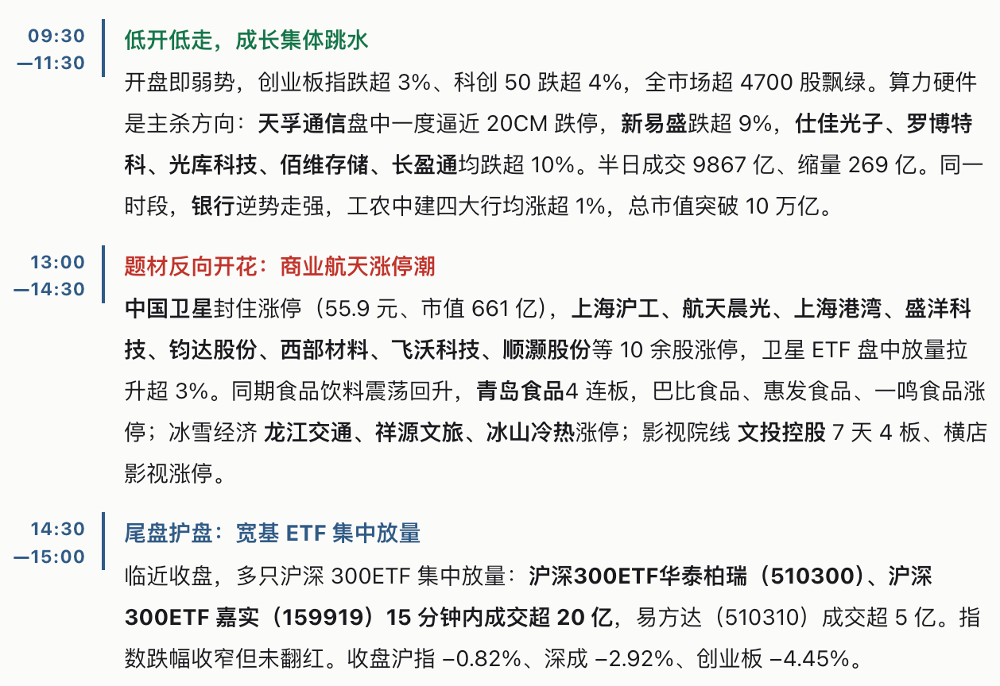
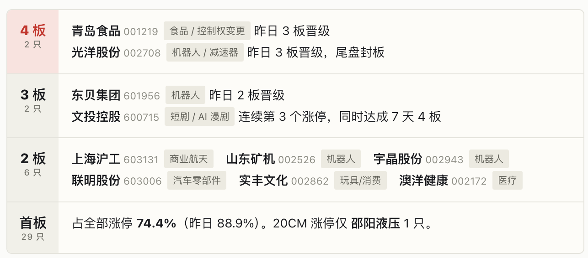

# 10.28复盘｜业绩最好的一天，却跌的最狠

A 股早报 · 2026.10.30 周五 · 盘前

> 30 秒速览
>
> 1. **昨天是亏钱效应主导**。沪指 −0.82%、创业板 *−4.45%*；跌停 41 家 > 涨停 39 家；上涨 753 家、下跌 4393 家，中位数 *−2.52%*。
> 2. **杀的是估值，不是业绩**。新易盛 Q3 净利 *环比 −19%*；天孚 Q3 营收增速只有 +31.50%（同业 80%/172%）；谷歌财报后跌 9.34%，微软涨 2.82%——同一夜，市场在给自由现金流定价。
> 3. **贴现率还在往上走**。FOMC 维持 3.75%—4.00%，10:2 通过，两位票委主张加息；12 月加息概率已升至 *85%—86%*。
> 4. **新主线接棒：商业航天**。中国卫星涨停（主力净流入超 11 亿，全市场第一），航天装备板块净流入 18.14 亿居首，概念整体超 30 亿。政策锚是上海六部门《卫星互联网行动方案（2027—2030）》。
> 5. **昨晚又添一条坏消息**。CoreWeave、NEBIUS 盘后集体重挫近 5%——因微软与谷歌资本开支未达最激进预期，市场开始担心下游算力转租商的现金流。这是对 A 股算力链的二次确认。
> 6. **今天两个硬约束。**① 三季报最后交易日（10/31 截止），未披露的小票是最大雷区；② 日本央行决议 + 植田记者会，若放鹰将冲击全球套息交易。
>

-----

先看一下昨日的市场。

成交 1.56 万亿、缩量 720 亿；涨停 71→39、跌停 7→41；上涨 753 家、下跌 4393 家、中位数 *−2.52%*。放量只维持了一天，赚钱效应极度低迷。

-----

新易盛 Q3 净利 **38.43 亿**，Q2 是 **47.49 亿**——环比 −19%。同比 +61.15% 很好看，但环比是负的。

天孚通信更直接，Q3 营收增速 **+31.50%**，而中际旭创 +171.83%、新易盛 +80.30%。

市场给成长股定价，一旦进入"高位 + 高预期"阶段，看的就是环比拐点，不是同比增速。**同样的赛道，增速掉队**，估值就要重定价。所以新易盛 -11.06%，天孚通信直接-19.77%。

最致命的一击来自谷歌。Q3财报不及预期，盘后一度跌超10%。作为全球AI算力的核心买家，谷歌业绩低于预期直接动摇了市场对AI基础设施投资持续性的信心。A股的算力硬件链——CPO、光模块、PCB——今天集体崩塌，这条传导链条清晰得令人心悸。

同一时间，美联储宣布维持利率不变，维持利率 3.75%—4.00%，**10 比 2** 通过，理事库克与克利夫兰联储主席哈马克投反对票、主张加息 25bp。声明把经济活动描述上调为"**强劲扩张**"，同时强调通胀。沃什拒绝提供前瞻指引，并宣布调整 FOMC 会议安排。

**12 月加息的预期超过 80%**，高盛、摩根大通、摩根士丹利、巴克莱、德银、瑞银、汇丰判断一致——12 月再加 25bp 至 4.00%—4.25%。

国内方面其实也不缺利好。

**上海六部门**发布《卫星互联网产业创新发展行动方案（2027—2030）》：2030 年在轨卫星超 3000 颗、核心产业规模超 800 亿元；这是今天商业航天涨停潮的唯一政策锚，也是全天最强的方向。

21家上市银行披露中期分红方案，合计拟派息超2600亿元。四大行 A+H 总市值盘中首破 10 万亿，工行建行续创新高，青岛银行 +8%。

**昨天的带队结构是"新主线 + 老防御"同时成立**，这很少见。原因不矛盾：商业航天是**进攻方向的替补**（科技退潮后资金需要一个能讲新故事的地方），银行是**风险偏好的避风港**（12 月加息预期升温 + 高股息）。一个是"换故事"，一个是"降风险"。

这些利好在当前脆弱的市场情绪面前，根本接不住科技成长股砸下来的恐慌盘。

----

再看一下短线连板

涨停从 71 降到 39、跌停从 7 增到 41，赚钱效应明显恶化；但封板率从 51% 升到 61%、炸板率从 50% 降到 39%、晋级率从 25% 回到约 50%。

数量崩塌、质量提升，是退潮中后段的典型形态。首板接力难度极大，短线资金对低位接力的信心严重不足。跌停数量反超涨停，这个信号在A股历史上并不常见，每一次出现都对应着情绪的极端冰点。

「羊」字辈玄学炒作成为今天最活跃的暗线。光洋股份4连板领衔，澳洋健康2连板，东方海洋4天2板，海阳科技、邵阳液压（20cm涨停，今日全市场唯一）、阳光照明、盛洋科技均涨停，襄阳轴承早盘一度冲击6连板。「羊」字辈能走多远，取决于市场情绪什么时候真正企稳——玄学炒作本身就是资金缺乏主线方向的体现。

襄阳轴承断板之后，光洋股份就成了机器人这条线的唯一高标。据公司公开信息，其轴承产品已进入多家机器人及减速器企业供应链——**这是有产业链验证的，和襄阳轴承"营收 16.11 万"是两个性质**。

而襄阳虽然断板，但是机构一直在接。叠加「羊」字辈高标断板之后，走势都很温和，没有A杀，后续可以低吸高抛。机构的买入更可能是**博弈"断板后的二次启动"**。

另外商业航天如果能够延续，上海护工是最可能晋级3板的，前提是中国卫星不能开的太差。

----

当市场情绪跌到冰点、跌停反超涨停这种极端信号出现的时候，往往也是底部区域正在形成的时候。当然，这不意味着明天就一定会涨。底部是一个区间，不是一个点。

在这种行情里，控仓比选股重要，耐心比操作重要。市场从不缺机会，缺的是等到机会时的本金。

⚠️ 风险提示：本文所有内容基于公开信息整理与分析，仅代表个人观点，不构成任何投资建议。文中提及的公司、板块仅为案例说明，不代表推荐。市场有风险，投资需谨慎。