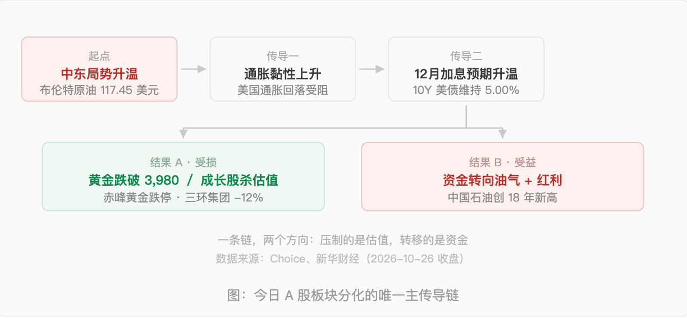
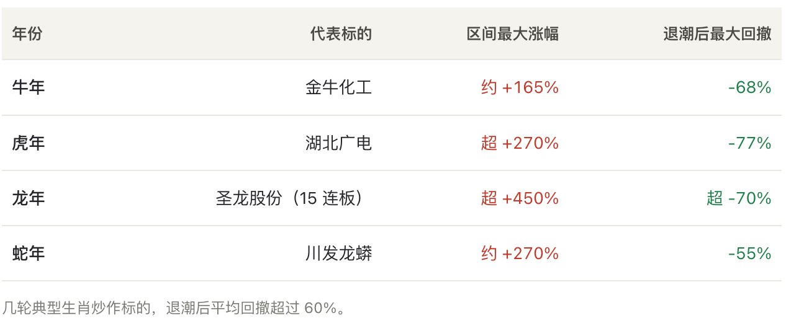

# 11.01｜终究还是错付了

A 股复盘 · 2026.10.30 周五 + 周末资讯

上周五是10月的最后一个交易日，市场用一根放量大阴线画了个句号。

三大指数今日集体大幅低开后一度冲高，午后买盘承接断裂，各指数反扑均被打回，几乎以最低点收盘。沪指再度失守3600点整数关口。

作为10月最后一个交易日，创业板指本月累计跌超23%，深成指、中证500月跌超15%，月度收官惨淡。

全市场893家上涨，4598家下跌，82家平盘，涨跌比约1:5.2；涨停47家（不含ST），跌停超80家，266只股票跌幅在9%以上。

沪深两市合计成交1.67万亿元，较上一交易日放量1179亿元，属于典型的放量杀跌，主力资金全天净流出314.33亿元，其中创业板净流出108.71亿元，科创板净流出68.84亿元。

这里有一个背离信号：**中际旭创主力净流入 14.26 亿、新易盛净流入 13.56 亿**，而这两只股价分别跌超 8% 和 10%**。光库科技**机构净买入 1.57 亿（居当日机构买入第一），股价仍大跌。

这不是抄底，是**被动调仓 + 指数化资金的机械买入**。当 ETF 仍在净流入（股票型 ETF 自 9/28 起已连续 18 个交易日净流入、合计超 3800 亿），权重股跌多少，被动资金就买多少——它不看价格，只看权重。"股价跌、主力买"在 ETF 时代不等于看多信号，它可能只是被动资金的算术结果。

-----

再看一下重要的消息面。

**上午 9 时左右，人民银行、证监会召集部分证券公司、基金公司开会，议题是"研究推动支持资本市场工具使用"**。同一天，人民银行、金融监管总局、证监会还将召集各大银行开会，**研究优化股票回购增持再贷款政策**。

两场会议同日、开盘前 30 分钟——这个时间点本身就是信号。**但这里要说的是：这不是推出新工具，是推动"使用"**。股票回购增持再贷款 2024 年 10 月设立、首期 3000 亿，互换便利也在；工具早就有，问题是券商用不用、银行放不放。

这对短期情绪来说是修复信号，直接利好券商、红利、权重，可能带来低开高走。如果还只是开动员会，那效果就是一次性的。

韩国10月出口同比增长93.7%（预期89.3%），进口增长36%，出口总额1153亿美元。韩国是全球半导体最上游的供给方，它的出口是"订单已经发生"的确认，不是预期、不是指引。芯片 +259%、计算机 +496.6%——这是实打实的出货。

但是，产业数据在创纪录，股价在崩盘。周五费半-7.2%、英特尔 −28.58%、闪迪 −13%、高通 −11%、AMD −10%、ARM −9%。谷歌连续第二个季度自由现金流为负，亚马逊、Meta自由现金流也已转负；英特尔下修四季度指引。**市场开始质疑AI资本开支的回报能力**。

英伟达在SEMICON West 2026展示了下一代CPO方案OOI（Optics-on-Interposer，中介层上集成光学），光引擎不再使用独立有机基板，而是与计算芯片共用硅中介层；同步展出8波长DWDM方案，单纤带宽达256Gb/s。英伟达已拿到原型样品。英伟达未公布任何商业化时间表。

当前仍处于LPO/NPO/CPO多方案并存阶段，可插拔光模块仍是明年主力。中短期看OOI不会对国内光通信产业产生影响，Rubin平台2026下半年导入第一代CPO、2027规模放量，OOI量产预计要到2030年之后。

三季报全部收官，5572家公司统计口径如下：

| 口径         | 数值                        | 同比                           |
| ------------ | --------------------------- | ------------------------------ |
| 营业收入     | 56.66 万亿                  | +5.66%（中报 +7.63%）          |
| 归母净利润   | 5.10 万亿（同比增长3908亿） | **+8.30%**（中报 **+19.40%**） |
| 盈利公司     | 4076 家（73.15%）           | —                              |
| 净利增长公司 | 2657 家（**47.68%**）       | —                              |

**利润增速从 +19.40% 掉到 +8.30%**，腰斩；**增长面只有 47.68%**，不到一半公司在增长。

再按板块拆分：

| 板块     |    归母净利 |         同比 |
| :------- | ----------: | -----------: |
| 沪深主板 | 45540.95 亿 |       +2.86% |
| 创业板   |  3024.13 亿 |      +22.61% |
| 科创板   |  2235.20 亿 | **+476.22%** |

拆开来看，科创板**长鑫科技前三季度营收 2690.24 亿（+738.51%）、归母净利 1320.40 亿**，单 Q3 营收 1187.14 亿（环比 +19.30%）、净利 889.83 亿（环比 +19.38%）。

也就是说全市场"多赚的 3900 亿"里，**三分之一来自一家刚上市的存储公司**。扣掉它，其余增量只有约 2586 亿。科创板的 +476%，近六成的利润来自长鑫。占利润九成的主板，几乎没增长。

**当"增长"高度依赖一条链、一家公司、一个涨价周期，那么一旦这条链的估值被贴现率压住，指数就没有第二个支点**。

----

再来说一下短线情绪。

连板股合计 9 只，3 板以上仅 3 只。涨停 49 只中首板 38 只（约 77.6%）**。连板股从 10 只降到 9 只、晋级率从 50% 掉到 30%，这是"高度还在、中位已断"的典型形态**。科技权重股持续深幅回调，高位连板股断板即A杀，短线赚钱效应全面崩塌。

市场最独特的风景线是「羊字辈」概念的**高低切换**。百洋股份、大洋电机跌停，光洋股份跌超8%，前期高位「羊」集体退潮。但低位「羊」密集补涨，沈阳机床、泉阳泉、阳普医疗、鲁阳节能、扬子新材、红太阳首板涨停，阳光照明、盛洋科技、东方海洋晋级2连板，澳洋健康走出3连板。趋势抱团龙头海洋王涨近9%续创阶段新高。

这里需要注意的是高位的大业股份、海洋王都没有压住异动，理论上利好低位，低位板块中异动的是医药、商业航天。如果被处刑，低位的「羊字辈」将会受到影响。

情绪冰点之后往往还有惯性下杀的过程。

----

新的一周，大家加油！

⚠️ 风险提示：本文所有内容基于公开信息整理与分析，仅代表个人观点，不构成任何投资建议。文中提及的公司、板块仅为案例说明，不代表推荐。市场有风险，投资需谨慎。