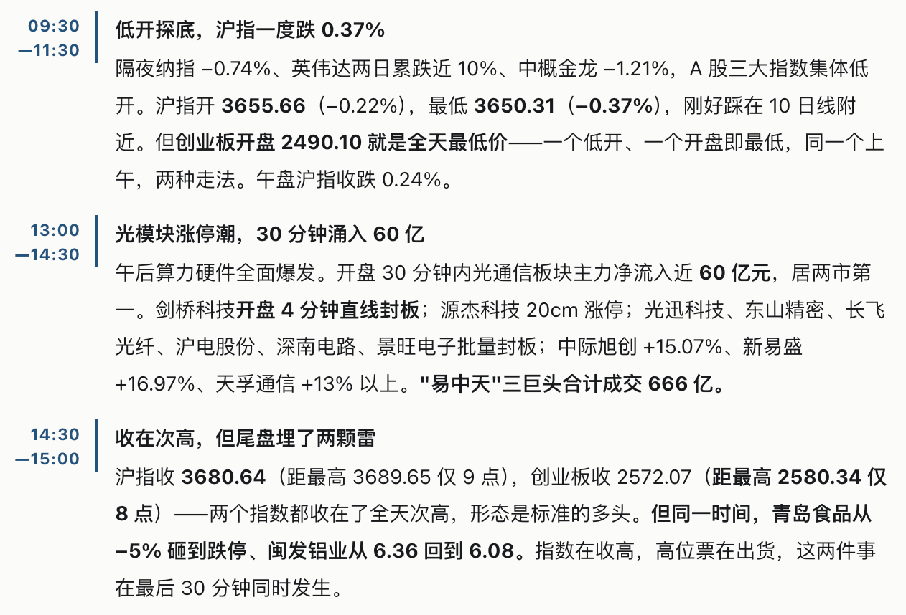
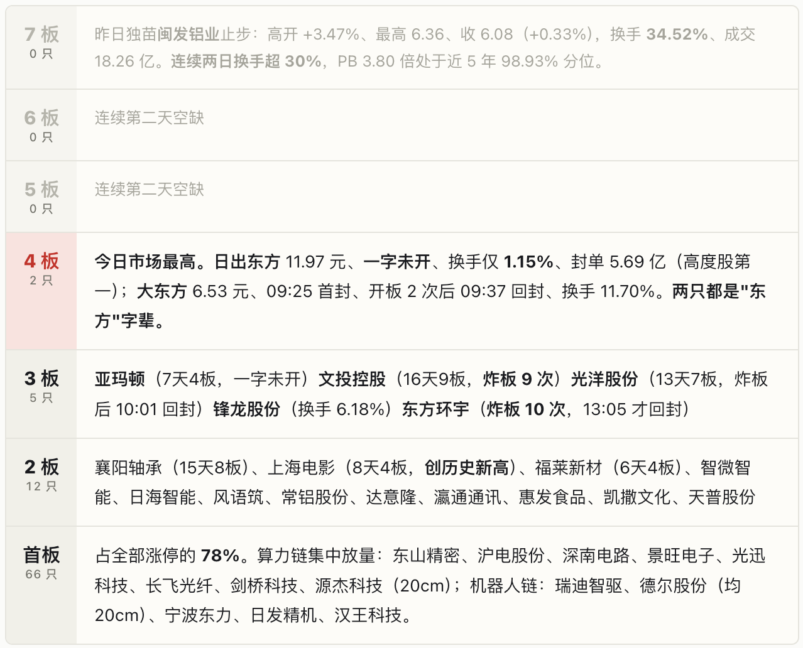

# 11.11｜科技全线反攻，连板梯队大洗牌

早盘三大指数集体低开，但开盘后即被资金快速拉起，午后在科技成长股的带动下加速上行，最终全线收涨，呈现明显的"V型"反弹格局。

涨停 **85** 只、跌停 **3** 只、封板率 **82%**、成交 **1.68 万亿**——表面看是热闹的一天。但最高板从昨天的 7 板直接砸到 **4 板**，中间 5、6 板全空，1 进 2 只剩 **16.4%**。**高度塌了**。另外这里有个容易被忽略的细节：**上证 50 今天是跌的（−0.27%）**。

指数大阳、上涨占比反而从昨天的 76% 降到 63%，这两个数放在一起，说明今天不是普涨，是**极窄的结构性行情**。

从资金流来看：

- 净流入前三：电子（+131.63亿）、通信（+113.09亿）、半导体（+47.60亿）
- 净流出前列：医药（-38.64亿）、电新行业（-35.26亿）、食品饮料（-22亿+）

**成交额前 15 名，12 个是算力链，合计近 1400 亿**。占全市场成交 *8.4%*。中际旭创 312.29 亿、新易盛 252.34 亿——**单主线集中度到了罕见的程度，这也是明天最大的风险来源。**

高度从 7 板断到 4 板，中间三档全空。闽发铝业 7 连板止步、收 *+0.33%*；连板高度直接落到日出东方、大东方两只 4 板。5 板、6 板、7 板三档同时为零。

"东方字辈"的两只人气股日出东方和大东方均成功晋级，短线人气没有完全溃散。文投控股走出16天9板的节奏，光洋股份13天7板，这两只"绕异动"成功后尝试走第二波，是后续观察短线情绪持续性的关键标的。

还有一个要说的就是东方通信，尾盘直线拉涨停。对东方系也是有带动性的。

明天可以观察两只4板的东方和闽发铝业，如果不及预期，就要降低仓位。如果科技出现分歧，则会开始新的轮动，如航天、医药之类的。

----

1. OpenAI Q3 营收首破 100 亿美元（环比 +50%）、Anthropic IPO 估值或提至 1.5 万亿、台积电 10 月营收 +59.7%、CoreWeave Q3 营收 +168%。

2. 市场流传头部存储原厂已向渠道商**口头告知**涨价意向，**提价函尚未正式下发**，但渠道端价格已先行上涨。

3. SpaceX 与德国 SINGULUS 签 HJT 整线合同，首条 2027 上半年交付，长期支持 100GW——此前市场预期的"200 亿国内订单"彻底落空"。

4. **隔夜美国 10 月 CPI** 环比 +0.4%（预期 0.3%），12 月加息 25bp 概率上升，10 年美债盘中破 5%。今天黄金大跌的主要原因。

就这样吧。

⚠️ 风险提示：本文所有内容基于公开信息整理与分析，仅代表个人观点，不构成任何投资建议。文中提及的公司、板块仅为案例说明，不代表推荐。市场有风险，投资需谨慎。
