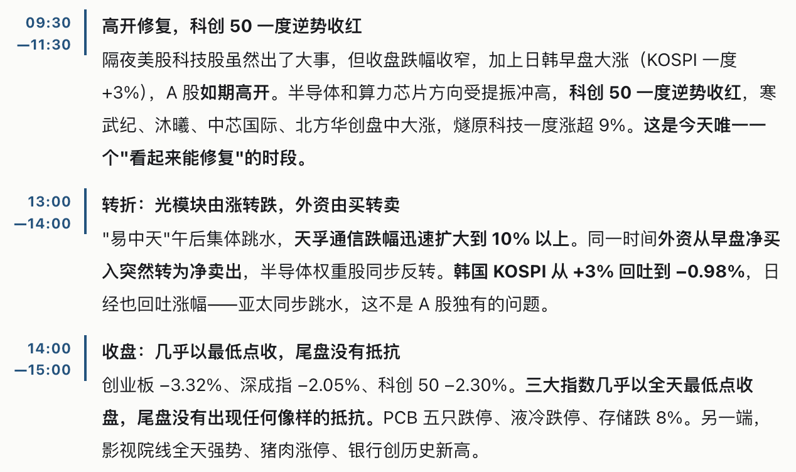
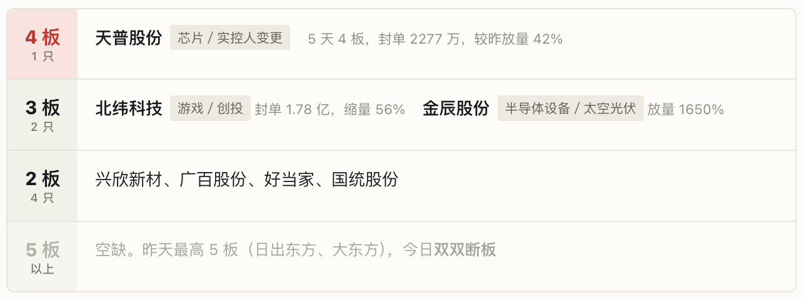

# 11.13｜权重护盘，个股血流成河

英伟达CEO黄仁勋真辞职了，英伟达跌4.34%。这条消息像一颗深水炸弹，直接引爆了全球算力链的估值重塑。A股的CPO、PCB、光模块首当其冲，「易中天」（中际旭创、新易盛、天孚通信）集体重挫超8%。

上证只跌 **0.59%**，但 4747 只股票下跌、上涨占比 **13.7%**、跌停 **33** 只——昨天是 7 只。

全天成交额约1.66万亿元，较前一交易日缩量2764亿元。这个缩量幅度说明资金在主动撤退，不是缩量企稳，而是缩量杀跌。

高标大多数都是大跌或跌停，整个短线情绪冷的一匹。

不过也有亮点，文投控股走出涨停反包，18天10板成为全市场最高标。说明AI短剧方向还是有资金认可的。

等周末看看有什么利好消息吧。

---

1、抖音集团短剧版权中心面向具备互动内容、短剧、漫剧或游戏制作能力的合作方，**开放互动剧与互动影游合作**。平台提供 IP 资源支持，推出三种合作模式与两项限时激励：**单剧最高 20 万元保底激励、30%–50% 的额外分成，多项激励可叠加**。

2、韩国总统李在明表示，韩国股市经历了大幅回调，韩国决心实现资产和资本市场的正常化。资本市场的核心关键词是"**信任**”。

结果就是韩国KOSPI指数高开，然后一路向西，尾盘收跌。说好的信任呢。

3、立冬后腌腊需求启动，能繁母猪存栏降至正常保有量以下，供需格局改善。天邦食品、金新农涨停，巨星农牧涨超5%。这个方向有基本面支撑，但今天属于首日爆发，明天需要观察是否有持续资金跟进。

---

好好的一个周五，走出了股灾的体感。这老黄的离职补偿竟然还要大A公子来发！

祝大家周末愉快！

⚠️ 风险提示：本文所有内容基于公开信息整理与分析，仅代表个人观点，不构成任何投资建议。文中提及的公司、板块仅为案例说明，不代表推荐。市场有风险，投资需谨慎。