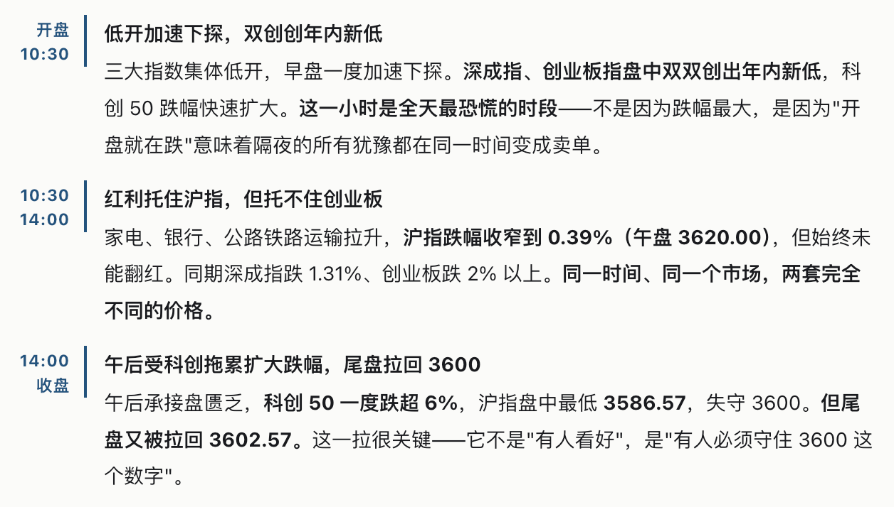
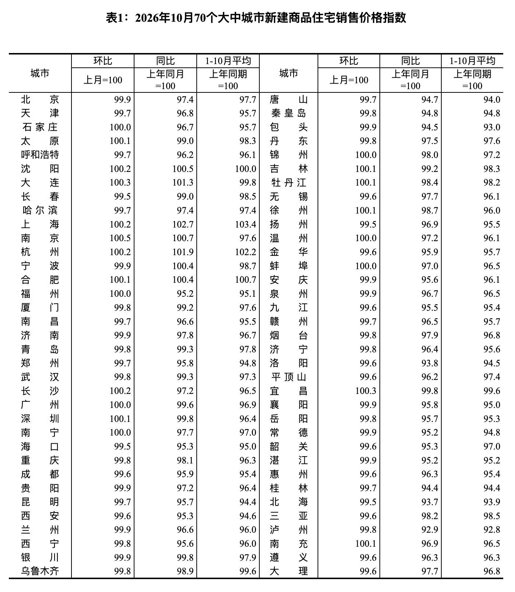

# 11.16｜钝刀子割肉，连续三天4300只下跌

一个字形容就是「惨」，两个字就是「残忍」。

三大指数集体低开低走，上证指数尾盘勉强守在3602.57点，跌了0.87%。深成指跌了2.53%，创业板更狠，直接跌了4.37%，创年内新低；科创50跌5.16%。全市场超过4300只个股下跌，赚钱效应几乎为零。

**有资金在关键点位做防守，说明 3600 是被认可的位置**。但是要知道指数回来了，个股没回来。

之前一直有人说，gjd是不是在撤退？上周宽基相关的ETF都没有放量，量能也很少。再加上今天尾盘，沪深300ETF华泰柏瑞突然放出超40亿的成交量，较上一交易日尾盘放量近2倍。这个动作，通常是机构资金或者「稳市场」力量在出手。算是一个不太明显的积极信号。

钝刀子割肉，连续三天4300只下跌。

| 日期      | 上证   | 下跌数量         | 上涨数量 |
| --------- | ------ | ---------------- | -------- |
| 11.12周四 | -0.67% | 4634             | 875      |
| 11.13周五 | -0.59% | 4747             | 765      |
| 11.16周一 | -0.87% | 4344             | 1136     |
| 累计      | -2.12% | **连续3天>4300** | -        |

钝刀比快刀更伤人的原因，不是跌幅，是"没有反弹"。因为钝刀的市场里，每一天都有人觉得"跌够了"，然后每天都被埋。**这些人的止损，构成了第二天的卖压**。

这里有一个背离：**沪电股份今天跌停，机构净买 2.68 亿、北向净买 1.89 亿**。

沪电股份是 PCB 龙头。今天 PCB 板块整体崩塌——**生益科技、景旺电子、东山精密、深南电路全部跌停**。

**这不是第一次了**，11/11 那天，东山精密涨停，机构净买 7.22 亿、6 席机构专用席位；11/13 PCB 集体跌停。**今天沪电跌停，机构又买了 2.68 亿**。

机构净买入不等于明天就涨。11/11 东山精密净买 7.22 亿，11/12 跌 6.33%，11/13 跌停。机构买了三天，跌了三天。

**"机构在买"只能说明"这个位置有人愿意接"，不能说明"这就是底"**。因为机构的钱可以等半年，你的钱不一定。

-----

上午十点，四组数据同时公布。

| 指标                    | 数值   | 说明                             |
| ----------------------- | ------ | -------------------------------- |
| 社零（10 月）           | +0.4%  | 46463 亿元，1—10 月累计 +1.0%    |
| 规上工业增加值          | +4.8%  | 比 9 月慢一档，1—10 月累计 +5.3% |
| 固定资产投资（1—10 月） | −8.1%  | 364824 亿元，扣除房地产 −5.1%    |
| 房地产开发投资          | −21.6% | 57215 亿元                       |

扣除房地产之后，固投还是 −5.1%。说明不只是地产的问题。结构里唯一的亮点在高技术：信息服务业投资 +20.5%、航空航天器及设备制造业 +10.2%、电子及通信设备制造业 +6.6%、知识产权产品投资 +9.2%。

70城数据里，一线新建商品住宅环比总体上涨；二线、三线环比下降。**一线二手住宅环比 +0.2%**（涨幅与上月相同），上海 +0.5%、广州 +0.2%、深圳 +0.1%、北京持平。

其他表格可以去[国家统计局网站](https://www.stats.gov.cn/sj/zxfb/202611/t20261116_1965836.html)上自行查看。

房价和股市是同一个结构，房价是"一线涨、其他跌"，股市是"银行涨、其他跌"。

截至发稿，美国股指期货跌幅扩大，道琼斯指数期货跌0.13%，标普500指数期货跌0.76%，纳斯达克100指数期货跌1.56%。SK海力士盘前跌超6%，英伟达盘前跌超4%。等明天再看具体情况吧，凶多吉少啊。

控制好仓位，保持耐心，好好生活，行情总会慢慢好起来的。

⚠️ 风险提示：本文所有内容基于公开信息整理与分析，仅代表个人观点，不构成任何投资建议。文中提及的公司、板块仅为案例说明，不代表推荐。市场有风险，投资需谨慎。