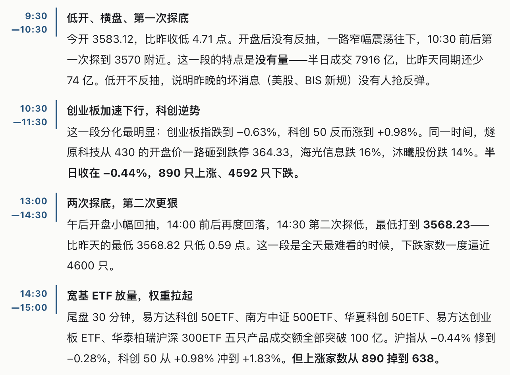

# 11.19｜地量复地量，科创扛大旗

今天的盘面又一次刷新了市场的冰点纪录。全市场成交额缩到 1.31 万亿，再度刷新年内地量，超 4800 只个股下跌，涨停家数仅剩 26 家创年内新低，跌停家数却高达 83 家，亏钱效应还在扩散。唯一的亮点是科创 50 逆势大涨近 2%，半导体、光刻胶方向逆势走强，尾盘宽基 ETF 放量异动，护盘信号非常明显。

今天的 70 只跌停里，最集中的五个堆是——AI 漫剧与影视院线 8 只、冰雪经济与旅游 7 只、算力芯片与 IT 服务 9 只、汽车零部件 7 只、家电小家电 5 只。这五个板块，恰好是 11 月前两周涨得最好的五个方向。

反过来看涨停的 23 只：芯片产业链 12 只、算力 3 只、机器人 2 只、PCB 1 只、化工 1 只、家电 1 只、电网 1 只、交运 1 只、地产 1 只。占比最高的是芯片产业链，超过一半。

**尾盘拉的是权重，杀的是小票**。而且不是两拨人干的——是同一笔钱。要拉上证 50 需要买银行、白酒、保险，这些钱从哪儿来？从当天最活跃的小票里卖出来。你看到的「尾盘拉升」，在指数上是 +0.16 点，在个股上是 252 只从红变绿。

另外三天的最低点分别是 （11.17）3565.59、（11.18）3568.82、（11.19）3568.23，感觉这一波的区间就在这里了。没人愿意在这个位置做方向，想卖的觉得已经跌了 5 天，想买的觉得量能不够。两边都在等，等的就是明天。

----

**美国 BIS 发布先进半导体远程访问新规**，这条消息在11月17日就已经说过了。核心两条：一是把出口管制从「硬件物理拦截」延伸到「云端算力穿透」，限制中国企业通过海外数据中心远程使用先进算力；二是 14nm 及以下先进制程，受限地区设计公司须进入「Approved IC Designer」名单，代工厂获审批后方可接单。11 月 19 日生效。

17日周二：**市场第一反应：利好国产替代**。当天国产 GPU 是全场最强主线，算力板块涨停潮。逻辑很顺：海外通道被堵，国产算力需求更刚性。

18日周三：**传闻出现：三星开始穿透严查代工**。这条传闻把「审批」具体化成了「断供」，性质变了——从「要多一道手续」变成「可能不给做了」。

19日周四：**上证报求证：传闻不准确**。记者向晶圆代工、芯片设计公司多方求证，得到的回复是「三星尚无严查代工的相关文件等规定，该传闻源于 BIS 11 月 16 日规定更新」。同时提到：14nm/7nm 制程因中国大陆本身具备能力，在三星的订单通过审批确定性很高；5nm 及以下需视芯片大小、用途而定。

解读为「利好国产替代」。本身没有错——远程访问被堵，确实会让国内的算力需求转向本地。但只读了新规的第一条，漏了第二条。

**设计公司要进白名单，代工厂要拿审批**。这条管的是「产能」，不是「市场」。国产 GPU 公司卖的是国内客户，但造的是台积电、三星的产线。市场被堵了可以转向，产能被卡了没法转向。

翻译过来就是：以前设计公司画完图，代工厂自己判断合不合规就能流片；现在要审批。

所以GPU 设计公司受影响最直接。而封测厂不受影响，封测是后道，接的是已经流完片的晶圆，管的是封装和测试，不在「先进制程代工」的定义里。所以蓝箭、大港涨停。

另外材料与设备反而受益。审批越严，国产流片的需求越刚性。格林达做显影液、江化微做超净高纯试剂、盛剑做废气处理设备——这些都是国内产线的耗材，越是被卡，越要扩产，所以它们涨停。

-----

控制好仓位，保持耐心，好好生活，行情总会慢慢好起来的。

⚠️ 风险提示：本文所有内容基于公开信息整理与分析，仅代表个人观点，不构成任何投资建议。文中提及的公司、板块仅为案例说明，不代表推荐。市场有风险，投资需谨慎。
