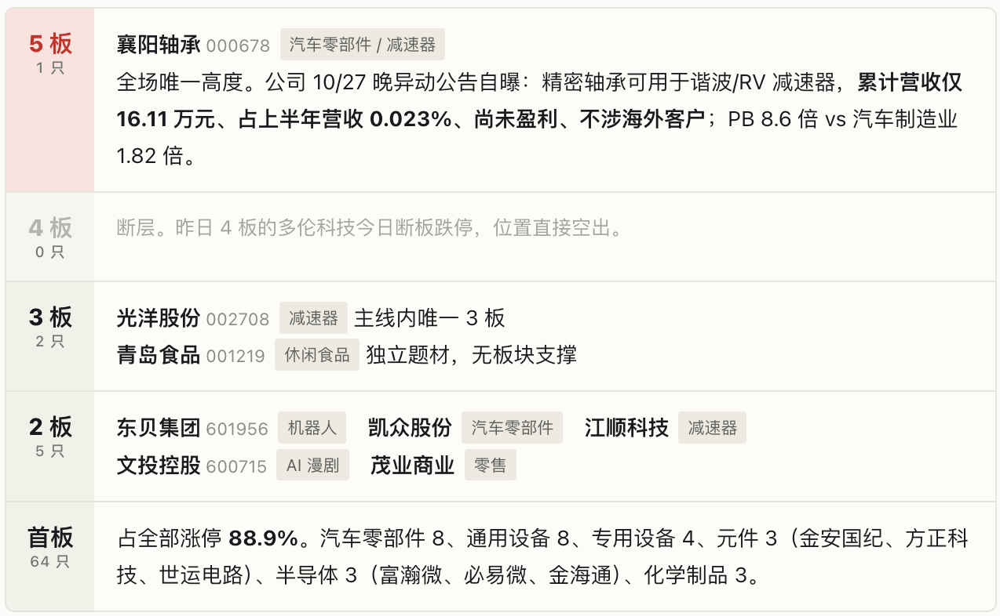
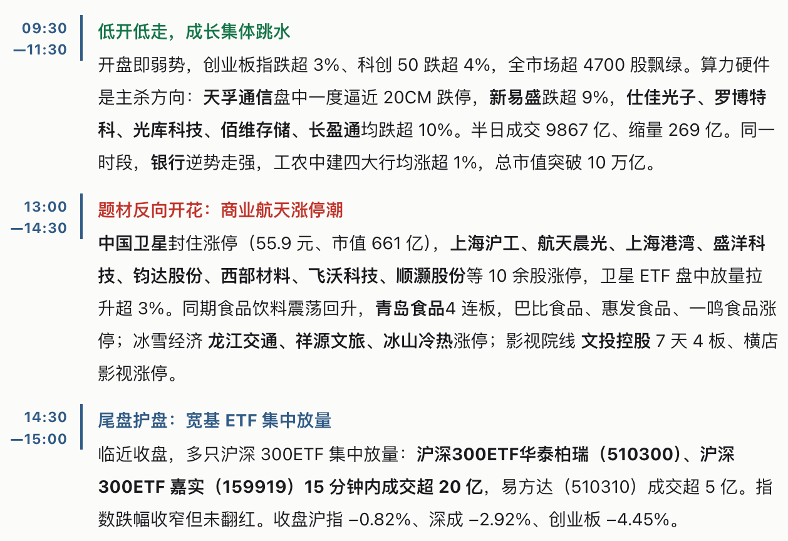

# 11.02｜11月开门红，但真正的考验在明天

A 股早报 · 2026.11.03 周二 · 盘前前瞻

昨天是情绪修复的一天，4600 只涨了、涨停 125、跌停 8，红盘率83.8%，中位数上涨+2.04%；

沪深两市全天成交1.78万亿元，比上一个交易日放量约1092亿，量能温和放大。

主线从物理AI转移到游戏传媒，游戏Ⅱ +9.06%、传媒 +9.98%，广告营销 9 涨停、出版 8、影视 7。算力链全程没参与：天孚 −4%、新易盛 −2.31%、中际旭创 −0.54%。

这里还有一个背离现象：**全市场83%的票在涨，成交额第一的中际旭创却还在跌**。

如果这是底，算力链应该跟着反弹；如果这不是底，那么指数的修复就只是"钱从算力链撤出来去了传媒和白酒"。

----

昨天最大的利好，应该就是**SFISF的1000 亿额度待投放**。

央行 11/2 公告：将于 **11 月 3 日**开展证券、基金、保险公司互换便利（SFISF）操作——这是工具创设以来第三次。目前 **31 家机构申报，申请额度超 1000 亿**。互换期限 1 年，费率有望进一步降低。

这条消息的性质和之前三部门会议不同：**会议是"用好用足"的表态，SFISF 操作是真金白银的投放**。1000 亿额度如果明天全部投放，意味着 31 家机构拿到了可以定向买股票和 ETF 的高等级流动性资产——**这是对科创 50 和权重股的直接增量**。

SFISF工具逻辑是机构把手里股票、ETF、债券质押，换成国债等高流动性资产，拿到低成本资金，核心作用是**打断赎回 - 卖出的负反馈**，不是央行直接进场买股票。后续还会扩容参与机构、降低互换费率、优化质押规则。

这个信号够明确了，政策端在主动给市场托底，不是喊口号，是真金白银在下场。

另外一条是AI漫剧的产业催化。央视财经报道，目前国内已有约10家企业建立海外短剧平台，另有十余个出海App上线了AI漫剧专属频道，海外市场AI漫剧活跃用户已超1.5亿。在海外短剧付费应用前十中，中国厂商占据九席。

这个消息直接引爆了整个AI漫剧和文化传媒板块。捷成股份、果麦文化、海看股份、华是科技、芒果超媒集体20CM涨停，奥飞娱乐、大晟文化、龙版传媒、浙文影业涨停。文化传媒板块超60家公司涨超9%，是当日毫无疑问的最强主线。

最近白酒涨的也还不错，主要是茅台业绩带来的消费信心。贵州茅台Q3净利199.51亿元，同比增长3.78%，环比增长15%，股价重回1400元创逾半年新高。白酒龙头的企稳带动了整个消费板块的价值修复，皇台酒业2连板，水井坊、金种子酒涨停。

------

再来说一下短线：6 板撑高度，首板撑宽度，5 板是空的。

涨跌比4681比818，普涨。涨停131只，是近一个月以来的最高值。封板率82%，说明做多意愿强烈，资金不怕封不住。连板晋级率55.6%，最高标6连板，连板高度在抬升，接力意愿回升。

青岛食品突破襄阳的高度压制，明天继续晋级就是破局，可以作为观察。另外【羊】字辈的澳洋，对其他【羊】也有续命效果。

机器人的核心还是襄阳轴承。

情绪这个东西没法精确量化，但今天的数据指向一个方向，就是短线情绪从前几天的修复期直接跳到了偏热区间。赚钱效应高涨，资金开始愿意做高，愿意接力。

不过也别太上头。每次情绪快速升温之后，分歧总会来的，问题只是什么时候来，以什么方式来。

-------

官军持续介入，再加上政策兜底，虽然他们买不一定立刻见底，但是离真正的底部应该不远了。根据历史经验，官军介入基本上就是下跌尾声了。

但是需要注意的是，**科技不止跌就一定会拖累指数**。

⚠️ 风险提示：本文所有内容基于公开信息整理与分析，仅代表个人观点，不构成任何投资建议。文中提及的公司、板块仅为案例说明，不代表推荐。市场有风险，投资需谨慎。