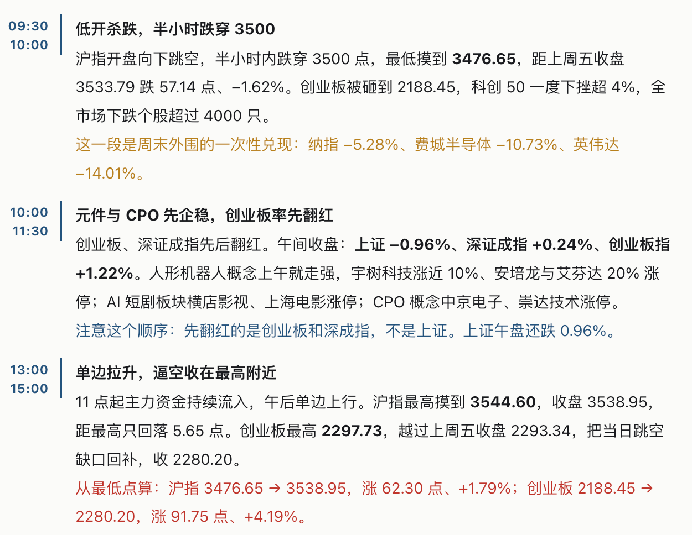
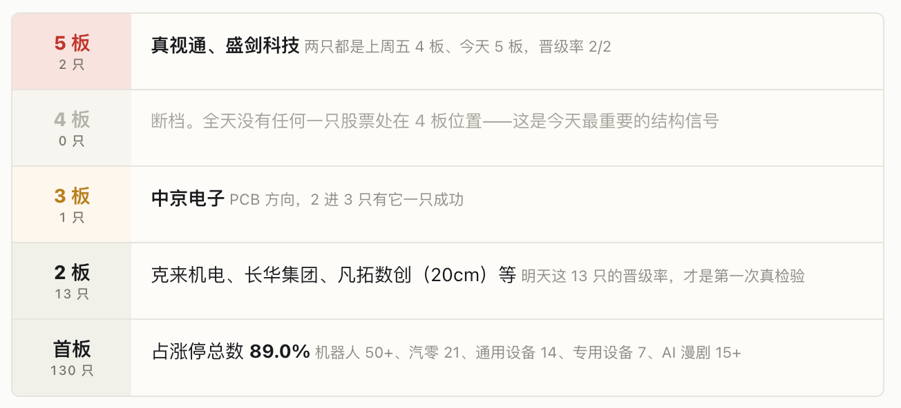

# 11.23｜拐点出现了

今天的日内节奏，跟 11 月 19 日正好是一个镜像。11 月 19 日是「高开—回落—收绿」，今天是「低开—翻红—逼空」。

跟昨天预判的差不多，“恐慌后修复” 的格局。沪深京三市合计1.55万亿到1.56万亿元，较上一交易日放量约1300亿元。

连续冰点之后，终于迎来了一个差不多的修复。算是一个关键节点。

全市场上涨4658只，下跌783只，平盘140只。上涨占比超过85%，这是典型的普涨格局。**涨停146只，跌停3只**。 其中近300只个股涨幅超过9%，赚钱效应全面修复。上证 50 跌 0.86%、中证 2000 涨 3.91%。

主要是权重在跌，上证50的成分股里，石油、白酒、银行、保险都在跌。

短线方面，最高连板5板。

真视通和盛剑科技两个互相卡位，盘中真视通炸板的时候，盛剑正好从底部往上拉，充分换手之后上板。

机器人今天高潮，作为本轮反弹的绝对主线，明天大概率会有分歧转一致的过程，核心标的分歧时反而是低吸机会。关注宇树科技、克来机电、长华集团等能否连板。

需要注意高潮之后必分歧，只适合低吸，后排会掉队。

AI应用方向，弹性的果麦文化、带头的是龙版传媒。

而另外的高标、有辨识度的个股是北纬、华东、九阳、冰山。高标全部晋级没有出现极端核按钮，短线情绪已经从前期退潮期切回修复通道。

这里看北纬科技能不能卡住异动，如果卡住，将会有不错的溢价，不能卡住，按现在的情绪应该也不会A杀。

今天算是一个拐点，各个群里又恢复了往日的欢声笑语。现在的行情应该比之前好很多了，看多做多吧。

⚠️ 风险提示：本文所有内容基于公开信息整理与分析，仅代表个人观点，不构成任何投资建议。文中提及的公司、板块仅为案例说明，不代表推荐。市场有风险，投资需谨慎。
