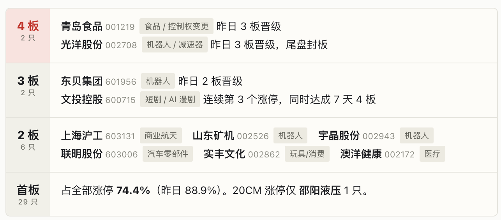

# 11.03｜千亿利好，接不住1273亿

A 股早报 · 2026.11.04 周三 · 盘前前瞻

昨天的大盘走出了利好兑现的行情，政策利好刺激出来的反弹，仅仅维持一天就宣告熄火。“低开—冲高—分化”，几乎没有像样的抵抗。尾盘勉强稳住。

上证指数收 3608.10 点，下跌 0.82%；深证成指 10876.99 点，下跌 1.21%；创业板指 2391.65 点，大跌 2.73%；科创 50 是今天的重灾区，收 1151.28 点，跌幅达到 3.81%，成长赛道杀估值的力度非常猛。

两市合计成交额 17034 亿，对比昨天直接缩量 803 亿，缩量下跌这个信号要重视，说明场内资金不愿意主动进场承接，观望情绪浓厚。涨跌家数这边，全天 2104 家上涨，3308 家下跌，161 家平盘，跌多涨少，大部分个股跑输指数，普跌格局。

尾盘那批 ETF 的量非常值得单独说。**六只宽基同日破百亿，这是国家队的手笔，不是散户的。**它托住了指数（上证 50 收红、沪指守住 3600），但托不住结构（创业板 −2.73%、科创 50 跌近 4%）。

还是昨天说的：**如果这是底，算力链应该跟着反弹**。

----

昨天的政策密度算是比较高的一天了，央行放 1000 亿互换便利、回购贷利率降到 1%、证监会改护盘式回购、20 家公告增持、发改委喊 10 万亿。

但光模块三巨头一天蒸发 **1273 亿**——中际旭创业绩 +173.74%，股价跌 12.69%。**钱能托住指数，托不住逻辑**。

| 标的         | 跌幅    | 市值蒸发    | 成交额                     |
| ------------ | ------- | ----------- | -------------------------- |
| 中际旭创     | −12.69% | 822 亿      | **293.2 亿**（全市场第一） |
| 新易盛       | −9.46%  | 253 亿      | 174.1 亿                   |
| 天孚通信     | −12.80% | 198 亿      | 85.8 亿                    |
| **三家合计** |         | **1273 亿** | —                          |

同日：生益科技跌停、光迅科技跌停、寒武纪 −10.81%、联特科技 −14.13%、光库科技 −12.86%、长芯博创 −12.57%、源杰科技 −10.78%、太辰光 −10.25%。**中际旭创自 6 月 22 日历史高点已回撤近 65%**。

这里的下跌可能源于一场收购。

Marvell宣布以全股票交易收购Lumentum，交易隐含企业价值约1150亿美元。通过整合DSP、定制芯片、激光器及光收发器等业务，Marvell试图**打通“芯片+光学”产业链**，抢占AI数据中心光互联市场。合并后公司潜在市场规模预计达5500亿美元，一场AI互联产业链整合由此拉开序幕。

Lumentum 是光模块上游的核心器件供应商（激光器芯片、光器件）。Marvell 把它买下来，等于**把上游组件握在自己手里**。对“易中天”这些中游模块厂来说，这意味着三件事：

**① 上游议价权被削弱**；原来可以比价采购，现在最大供应商之一成了客户的母公司。
**② 垂直整合威胁**；Marvell 有了"芯片 + 器件 + 模块"的全链条能力，可以直接做整体方案，绕开中游。
**③ 竞争格局重排**；过去市场给光模块的估值，隐含假设是"中游是价值捕获环节"。这个假设被动摇了。

**所以今天杀的不是估值（PE），是商业模式的可延续性**。这比杀估值狠得多——估值可以修复，模式一旦被质疑，要等下一个季度的订单数据才能证伪。

央行3日宣布，为加强金融机构外汇流动性管理，决定自2026年11月15日起，上调金融机构外汇存款准备金率2个百分点，即外汇存款准备金率由现行的4%提高到6%。

这是近五年来首次上调。说白了，银行吸收的外汇存款要多交 2 个百分点给央行。按外币存款约 1.2 万亿美元算，差不多冻结 **240 亿美元**外汇流动性。

政策公布后市场已有反应——离岸人民币一度跌破 6.67，在岸收报 6.6765，较前日跌 307 个基点。

世界黄金协会（WGC）周二发布的报告显示，**在截至9月底的三个月，各国央行净买入321吨黄金**。在2026年初购金节奏相对缓慢后，各国央行今年迄今的黄金购买量预估达675吨，略高于去年同期。

**自2月末美伊冲突爆发以来，黄金价格已下跌约四分之一**。尽管金价面临油价走高与利率上行带来的压力，**各国央行在第三季度仍以2024年末以来最快的速度买入黄金**。

**美国中期选举开票**（北京时间今早陆续出结果）。重点看众议院归属，以及民主党是否如预测净增 20 席以上。

还有一个是**半导体封测年会（南京，11/4—11/6）**——华天科技、长电科技、通富微电等参会。这是光模块之外唯一有独立催化的方向，**先进封装可能被拿出来做对冲**。

------

再来说一下短线：6 板断、4 板接、高度掉两级。

涨停从 125 腰斩到 52、红盘率从 83.8% 掉到 38.9%、最高板从 6 降到 4，跌停从 8 升到 17。**11 只昨日连板里只有 3 只晋级**。

而涨停里最大的一个集群，是"**羊/洋/阳**"谐音股：太阳能、大西洋、鲁阳节能、岳阳兴长、圣阳股份、华阳国际等 8 只封板。唯一共同点是名字里带 yang 音，**没有公告、没有政策、没有产业数据、没有券商报告**。

**玄学股大面积涨停，从来不是牛市的开始**。

-------

等一个恐慌盘，买点要后置，才更有性价比。

**科技不止跌就一定会拖累指数**。

⚠️ 风险提示：本文所有内容基于公开信息整理与分析，仅代表个人观点，不构成任何投资建议。文中提及的公司、板块仅为案例说明，不代表推荐。市场有风险，投资需谨慎。