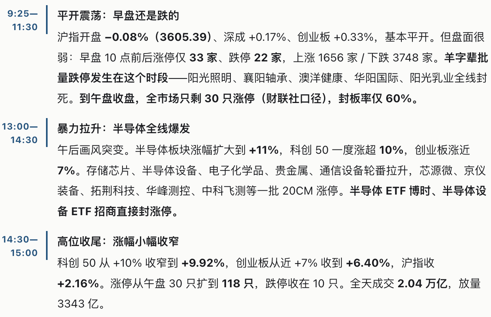

# 11.04｜牛回，速归！

A 股早报 · 2026.11.05 周四 · 盘前前瞻

昨天沪指 **+2.16%**、创业板 **+6.40%**、科创 50 **+9.92%**，成交重回 **2.04 万亿**，主力净流入 **521 亿**。半导体ETF集体涨停，全市场超百股涨停。这种级别的单日反转，放在A股历史上也算得上「名场面」了。

中午休市期间，高盛那份"NAND 明年均价 +34%/+30%"的报告在机构圈传开，加上上午已经确认"央行互换便利落地、券商中标超 340 亿"，两条一叠加，下午开盘就是抢筹。

----

再说一下短线

全市场共计118只个股涨停（不含ST及未开板新股），33只炸板，封板率78%。连板晋级率40%，市场连板高度压缩至3连板。

**退潮方面**，此前市场热捧的「羊字辈」概念今天遭遇全面退潮。阳光照明、澳洋健康、泉阳泉、阳光乳业、百洋股份等多股跌停。投机资金从纯情绪炒作中撤退，转向有基本面支撑的科技方向，这是今天盘面最重要的结构变化之一。

**半导体产业链**，作为最强主线，这条线的逻辑很硬，国产替代加速是长期主题，叠加回购增持再贷款降息的短期催化，明天大概率会有惯性冲高。但需要注意，板块单日涨10%之后，分歧是必然的，明天开盘前半小时的承接力度是关键观察点。

----

**海外方面**，最大的催化剂是美国中期选举结果。民主党重夺国会两院控制权，全球市场集体回暖，美股期货同步拉升，标普500期货一度涨0.6%。

这个结果意味着特朗普第二任期的政策推进将面临更大阻力，市场对此的解读偏向「风险偏好修复」。川普最大的败笔应该就是打了伊朗，到中期选举也没有彻底解决。

**国内政策端**

第一条，央行宣布自11月4日起下调股票回购增持再贷款利率0.25个百分点至1%，支持比例提升至100%。这是直接给上市公司「送子弹」，降低回购成本，信号意义很强。

另一个是发改委表示预计到「十五五」末新兴支柱产业产值有望翻一番，达到10万亿元以上。这条偏中长期，但对科技成长方向的情绪提振是实打实的。

**公司层面**也有看点。长鑫科技董事长将回购金额从「10亿至20亿元」上调至「25亿至50亿元」，今天成交额突破200亿，是全市场成交额最大的个股之一。中际旭创澄清砍单传闻，表示绝大部分客户未下修需求，2027年订单基本锁定。游族网络子公司签下42.25亿元GPU产品采购合同。

------

**昨天的浮盈，是今天的抛压**。昨天下午 13:00 之后买进去的人，成本就在那个位置。今天只要高开 2%，他们手里就是 5%—8% 的浮盈。这批人不是来接力的，是来兑现的——**而他们要兑现，就必须有人在高位接**。

所以先看高开之后能站不站得住，再谈加不加仓。

⚠️ 风险提示：本文所有内容基于公开信息整理与分析，仅代表个人观点，不构成任何投资建议。文中提及的公司、板块仅为案例说明，不代表推荐。市场有风险，投资需谨慎。