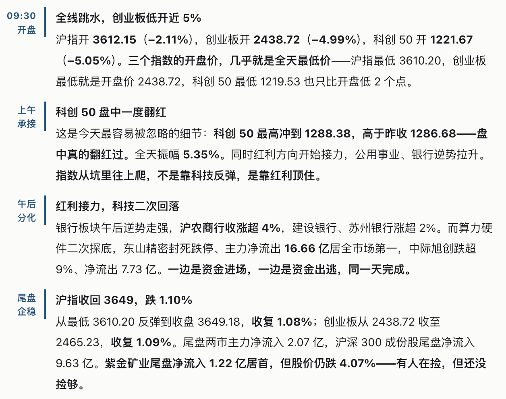

# 11.08｜周五兑现外围利空，国常会再提稳市

先对周五市场做一下复盘：

**上证指数收 3649.18 点，下跌 1.10%**；**深证成指收 11175.78 点，下跌 2.57%**；**创业板指收 2465.23 点，大跌 3.96%**；**科创综指收 1496.36 点，下跌 3.24%**。成长指数全线领跌，跌幅是主板的三倍以上，典型的成长杀估值行情。

两市合计成交额**1.66 万亿元**，相比周四的 2.12 万亿直接缩量 4600 亿。

再来看一下最近几天行情的事件传导链条。

| 时间      | 事件                                                         | 盘面反应             |
| --------- | ------------------------------------------------------------ | -------------------- |
| 11/5 美东 | 纳斯达克 100 暴跌 **6.4%**，单日市值蒸发 **2.3 万亿美元**    | 全球 AI 资产同步重估 |
| 11/6 美东 | 费城半导体指数 **−12.25%**，2020 年 3 月以来最大单日跌幅     | A 股算力链直接对标   |
| 11/6 亚太 | 韩国综指盘中 **−8.78%** 触发熔断，收 **−6.02%**；日经 225 **−7%+**，跌破 6 万点，进入技术性熊市 | A 股低开 −2.11%      |
| 11/6 午间 | 七家龙头集体公告回购，"在手订单充足"                         | **科技股跌幅收窄**   |
| 11/6 盘后 | 六家券商宣布完成互换便利首批买入                             | **次日情绪支撑**     |
| 11/6 美东 | 费半**反弹超 4%**，AMD **+11%**、英特尔 +7%、台积电 +6%      | **下周一的直接变量** |

最后一行最有看头，这意味着：**A 股周五的下跌，是在替一个"已经被修复的利空"买单。**但也不能简单说"周一必反弹"！

11 月 6 日国务院常务会议明确提出：**"完善资本市场稳市机制，增强股市内在稳定性，促进资本市场平稳健康发展。"**

这十几个字值得逐字读。**关键词是"机制"和"内在稳定性"，不是"活跃"、不是"提振"、更不是"救市"**。这个措辞变化的分量在于：它把稳市从"临时动作"变成了"制度安排"。临时动作是有期限的，制度安排是没有期限的。**对市场而言，这意味着"下限被锁住了"，但"上限没有被打开"。**

但也要客观说，国常会是定调，不是立刻出新工具。市场现在对政策已经有一定 “免疫力”，不是出个消息就立刻大涨，资金需要看到真金白银的增量资金进场。

美国 10 月非农新增 **16.5 万人**，市场预期 6.5 万——**超预期 1.5 倍**。8、9 月合计上修 8.4 万；失业率降至 **4.1%**，平均时薪同比 **+3.1%**。

数据公布后，**市场对美联储 12 月加息的预期进一步升温**。市场对美联储 12 月加息 25 个基点的概率直接拉到了 80% 左右，美元指数大涨，美债收益率上行。这对全球高估值成长股都是压制，A 股的科技、半导体、新能源赛道也会受情绪扰动。

----

最后再说一句：这周的行情，完美演绎了 A 股的 “快”—— 反弹快，下跌更快。很多人周四还在畅想牛市，周五就开始骂熊市了。其实市场没变，变的是情绪。

政策底已经明牌了，3500 点附近的支撑是实打实的。但市场底从来不是一个点，而是一个区间，反复震荡、来回磨人，就是底部的常态。

趋势是向上的，道路是曲折的。

⚠️ 风险提示：本文所有内容基于公开信息整理与分析，仅代表个人观点，不构成任何投资建议。文中提及的公司、板块仅为案例说明，不代表推荐。市场有风险，投资需谨慎。